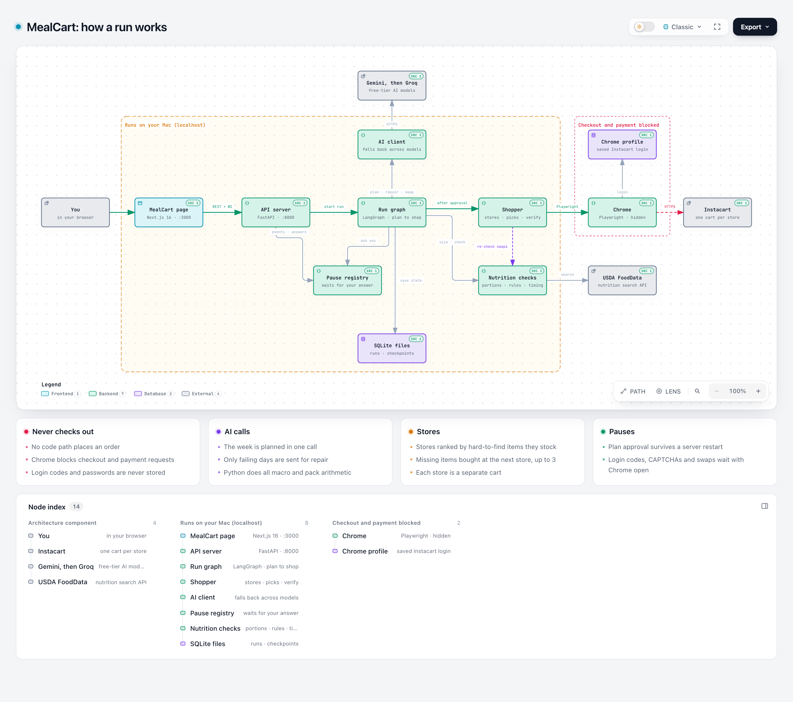

# Architecture and data flow

Prompt-to-Plate is implemented as **MealCart**, a single-user app that runs on the user's own Mac. The
source is in [`/app/`](../app/). The diagram below is interactive in a browser:
[`architecture.html`](architecture.html) (generated with Archify from
[`architecture.archify.json`](architecture.archify.json)).

## Components

| Layer | What it is | Where |
|---|---|---|
| Client UI | Next.js 16 page: request form, meal calendar, meal pop-up, grocery list, cart review, Activity drawer | `app/frontend/` |
| Backend API | FastAPI: REST to start and read a run, one WebSocket per run for live events and answers | `app/backend/app/api/` |
| Orchestration | LangGraph state machine with interrupts for human decisions, run in a background task | `app/backend/app/graph/` |
| Model endpoints | Any OpenAI-compatible endpoint: Gemini (primary), Groq, Cerebras, DeepSeek, OpenRouter, Ollama | `app/backend/app/planner/llm.py` |
| Grounding data | USDA FoodData Central lookups, cached in SQLite | `app/backend/app/nutrition/usda.py` |
| Deterministic checks | Portion solver (SciPy), validator, cooking-time floors, pack-size maths | `app/backend/app/nutrition/`, `shopping/packs.py` |
| Database | SQLite: runs, human-in-the-loop events, AI calls, USDA cache, price history; separate checkpoint file | `app/backend/app/db.py` |
| API connectors | Playwright driving the user's real Chrome profile against Instacart; checkout guard on every browser context | `app/backend/app/shopping/` |
| Vector store | **None.** Grounding is exact USDA lookups plus a cache, not similarity search, because nutrition arithmetic has to be exact | n/a |

## One run, step by step

1. **Request.** The page posts the targets, preferences and ZIP to `POST /api/runs` (or free text, which
   an intake prompt turns into the same form). The server starts the run and the page opens
   `WS /api/runs/{id}/events`, which replays any events it missed.
2. **Intake** (`graph/nodes.py: intake`). Conflicting preferences are resolved in favour of the user's
   exclusions (a chicken request from a vegetarian drops the chicken) and infeasible targets produce warnings.
3. **Plan** (LLM, schema `MealPlan`). The model chooses meals and ingredients for the 7 days in one call.
4. **Solve** (Python). A SciPy solver sets the gram weights so each day lands on the calorie and protein
   targets, using USDA macros per 100 g. Cooking times are raised to realistic floors (raw chicken, rice,
   dried beans).
5. **Validate** (Python). Each day is checked: calories within 5%, protein within 10 g, no allergen,
   restriction or disliked food, equipment and time limits, variety. Failing days go to **Repair** (LLM,
   failing days only, up to 3 rounds) and back through solve and validate.
6. **Consolidate** (Python). Ingredients become a grocery list, pantry items are removed, substitutes
   are attached.
7. **Plan approval** (human). The graph pauses with `interrupt()`. The user reads the meals, can swap
   a meal (LLM, one `Meal`, then solve and validate again) or untick list items, and approves.
8. **Shop** (Playwright). One LLM call shortlists stores. The shopper searches Instacart, an LLM picks
   the product for each item from numbered candidates, and Python computes how many packs are needed.
   Items a store doesn't stock go to the next store (up to 3). The checkout guard blocks checkout, order
   and payment traffic.
9. **Verify and review.** The cart is read back from Instacart and compared with the list: grams needed
   against grams in the cart, per-store subtotals, budget. The user checks out manually. The app never does.

Pauses that can happen during shopping (login code, CAPTCHA, substitute, clearing a non-empty cart) keep
the browser open while the user answers through the page. Answers go straight to the waiting code
and are never stored.

## Where the model is and is not trusted

| The model does | Python does |
|---|---|
| Choose meals and ingredients | Portions, calories, protein, carbs, fat |
| Repair failing days | Every pass/fail check, grocery list, pack counts, prices, cooking-time floors |
| Shortlist stores and match items to products | Coverage check of the final cart, the checkout block |

This split follows the Checkpoint 2 evidence: models were inconsistent at nutrition arithmetic and
cart coverage ([validation/GAP_ANALYSIS.md](../validation/GAP_ANALYSIS.md)).

## Changes since the diagram was drawn

The diagram shows the structure and is still correct. Four behaviours were added afterwards and are
described in [observability.md](observability.md) and [safety_privacy.md](safety_privacy.md):
hedged requests to backup models (a second model is asked if the first is silent for 45 s), a cooldown
that puts failing models last, store selection that tries one store first and others only for missing
items, and three browser tabs searching in parallel.
